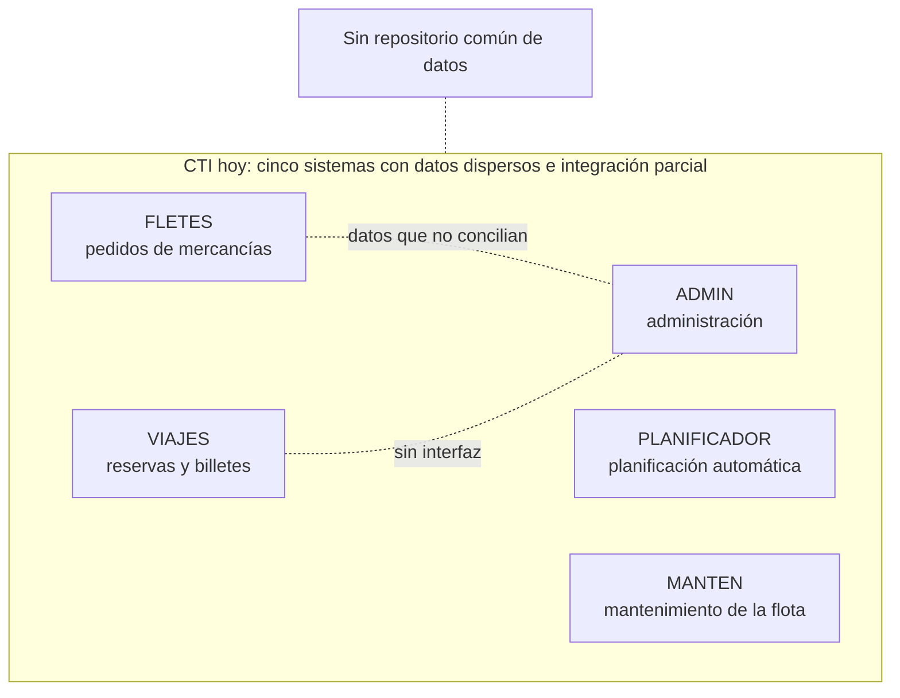
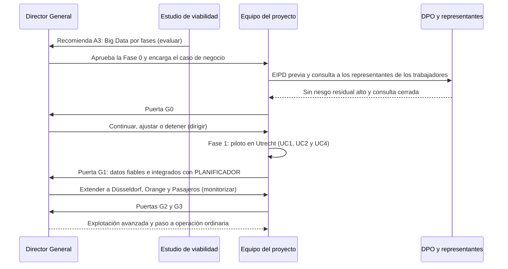

<div align="center">

# 🚛 CTI – Estudio de Viabilidad de un Sistema de Big Data

### *Estudio cualitativo (EVS), análisis de impacto, matriz ponderada de alternativas y una propuesta ejecutable por fases con puertas de decisión*

**Asignatura: Servicios de Tecnología de la Información · UNIR · Actividad No. 1**

[]()
[]()
[]()
[]()
[]()
[]()
[]()

**[Contexto](#-contexto-y-alcance) • [Contenido](#-contenido-del-repositorio) • [Marcos](#-marcos-y-herramientas-utilizados) • [Arquitectura](#️-arquitectura-de-referencia) • [Lectura](#-lectura-del-documento) • [Validación](#-cómo-se-respaldan-las-valoraciones) • [Autor](#-autor)**


</div>

---

## 📋 Tabla de Contenidos

- [🎯 Contexto y Alcance](#-contexto-y-alcance)
- [📁 Contenido del Repositorio](#-contenido-del-repositorio)
- [🧰 Marcos y Herramientas Utilizados](#-marcos-y-herramientas-utilizados)
- [🏗️ Arquitectura de Referencia](#️-arquitectura-de-referencia)
- [🗃️ Situación Actual de CTI](#️-situación-actual-de-cti)
- [🔁 Flujo de una Decisión](#-flujo-de-una-decisión)
- [⚖️ Alternativas y Recomendación](#️-alternativas-y-recomendación)
- [🧩 Del Enunciado al Documento](#-del-enunciado-al-documento)
- [📖 Lectura del Documento](#-lectura-del-documento)
- [🗂️ Tablas y Figuras del Documento](#️-tablas-y-figuras-del-documento)
- [🧪 Cómo se Respaldan las Valoraciones](#-cómo-se-respaldan-las-valoraciones)
- [✅ Buenas Prácticas Aplicadas](#-buenas-prácticas-aplicadas)
- [🔐 Alcance y Limitaciones](#-alcance-y-limitaciones)
- [📝 Nota](#-nota)
- [👤 Autor](#-autor)

---

## 🎯 Contexto y Alcance

Este repositorio contiene el documento de la **Actividad No. 1: Realización de un estudio de viabilidad** de la asignatura **Servicios de Tecnología de la Información** (UNIR), aplicado al caso de la **Compañía de Transporte Internacional, S.L. (CTI)**. El estudio responde a una pregunta del Director General: **¿conviene implantar un sistema de Big Data?**

CTI opera con **1.200 camiones, 350 autobuses y 2.800 empleados** (2.200 conductores) en tres regiones, con **cinco sistemas con datos dispersos e integración parcial**. Sus clientes exigen entregas **just-in-time** que hoy no puede atender, y la utilización de la flota es baja. El documento sigue el **Estudio de Viabilidad del Sistema (EVS)** de Métrica v3 y valora las alternativas con **Val IT** e **ISO/IEC 38500**.

> **Documento:** estudio de viabilidad cualitativo, sin evaluación económica, caso de negocio ni indicadores.
> **Enfoque:** análisis de impacto, evaluación cualitativa, matriz ponderada y privacidad por diseño.
> **Alcance:** 4 alternativas → 1 recomendación (A3) → 4 fases con 4 puertas de decisión → piloto en Utrecht.

### 🌟 ¿Qué aporta este estudio?

- 📊 **Análisis de impacto** en procesos de negocio, personas y tecnología, con las acciones para mitigarlo (Tabla 1).
- ⚖️ **Evaluación cualitativa** de beneficios frente a factores en contra y una recomendación final razonada (Tabla 2).
- 📏 **Datos objetivos del caso** que respaldan cada juicio y verificación de las **tres condiciones de inversión** (Tablas 3 y 4).
- 🔀 **Matriz ponderada** de siete criterios para comparar las cuatro alternativas de forma explícita y reproducible (Tabla 6).
- 🏗️ **Arquitectura de referencia por capas** que respeta los sistemas actuales en lugar de sustituirlos.
- 🗺️ **Hoja de ruta con puertas de decisión** y un análisis de sensibilidad que indica cuándo cambiaría la recomendación.

---

## 📁 Contenido del Repositorio

<table align="center">
  <tr><th>Elemento</th><th>Descripción</th></tr>
  <tr><td colspan="2"><b>📂 raíz</b></td></tr>
  <tr><td><code>Desarrollo_Actividad_1_Alejandro_De_Mendoza_Final.pdf</code></td><td>📄 <b>Documento final</b> del estudio de viabilidad: <b>20 páginas</b>, 9 secciones, 12 tablas numeradas (más 2 sin número en la sección 2) y 4 figuras</td></tr>
  <tr><td><code>README.md</code></td><td>📘 Este documento</td></tr>
  <tr><td><code>.gitignore</code></td><td>🚫 Lista blanca: solo se publican el PDF, el README y el propio <code>.gitignore</code>. Los archivos editables (Word) y el material de la actividad se conservan en local</td></tr>
  <tr><td colspan="2"><b>📑 Secciones del PDF</b></td></tr>
  <tr><td><b>1</b> Introducción</td><td>🧭 Propósito con <b>resumen ejecutivo</b>, alcance, definiciones, referencias y visión general</td></tr>
  <tr><td><b>2</b> Memoria explicativa</td><td>🧠 Enfoque metodológico y alternativas (dos tablas sin número), criterios, supuestos y límites</td></tr>
  <tr><td><b>3</b> Situación actual</td><td>🔎 Diagnóstico de CTI (EVS 2) y requisitos de alto nivel R1–R6 (EVS 3)</td></tr>
  <tr><td><b>4</b> Análisis de impacto</td><td>📊 <b>Tabla 1</b>: procesos de negocio, personas y tecnología</td></tr>
  <tr><td><b>5</b> Evaluación cualitativa</td><td>⚖️ <b>Tabla 2</b> y recomendación final; <b>5.1</b> datos objetivos y <b>5.2</b> tres condiciones de inversión</td></tr>
  <tr><td><b>6</b> Desarrollo adicional</td><td>🏗️ Arquitectura, casos de uso, matriz ponderada, riesgos, RGPD, gobierno, RACI, hoja de ruta y sensibilidad</td></tr>
  <tr><td><b>7–9</b></td><td>📝 Conclusiones, bibliografía y agradecimiento</td></tr>
</table>

---

## 🧰 Marcos y Herramientas Utilizados

<div align="center">


</div>

| Marco o norma | Uso en el estudio |
|:---|:---|
| **Métrica v3 (EVS)** | Estructura del estudio: alcance, situación actual, requisitos, alternativas, valoración y selección |
| **Val IT** | Criterios de valoración de las alternativas: estrategia, arquitectura, valor y entrega |
| **ISO/IEC 38500** | Principios de gobierno de TI y sus funciones: evaluar, dirigir y monitorizar |
| **ITIL / ISO/IEC 20000** | Operación del sistema como servicio |
| **ISO/IEC 27001** | Seguridad de la información |
| **ISO 22301** | Plan de continuidad del negocio de la plataforma |
| **ISO/IEC 19770** | Inventario de licencias y activos de software |
| **RGPD (Reglamento UE 2016/679)** | Base jurídica, minimización y evaluación de impacto (EIPD) previa |
| **Matriz RACI** | Asignación de responsabilidades del proyecto |

---

## 🏗️ Arquitectura de Referencia


La plataforma **no modifica los sistemas actuales**: captura sus cambios, trabaja con datos mínimos y pseudonimizados desde la zona depurada, mantiene los datos en la UE con formatos abiertos y **cierra el ciclo** devolviendo recomendaciones a PLANIFICADOR y MANTEN. Una plataforma en la nube de la UE es un **gasto operativo (OPEX)** más flexible que renovar el hardware obsoleto de Orange, que sería **gasto de capital (CAPEX)**.

---

## 🗃️ Situación Actual de CTI



| Dato del caso | Valor |
|:---|:---|
| 🚚 Flota | 1.550 vehículos (1.200 camiones y 350 autobuses) |
| 👷 Conductores | 2.200 de 2.800 empleados |
| 💽 Almacenamiento total | unos 1,5 TB (800 + 400 + 300 GB) |
| 📞 Oficinas locales con módem | 8 de 20 |
| 🧑‍💻 Gerentes de sistemas | 13 (5 en Utrecht y 4 en cada una de las otras dos regiones) |
| 🗓️ Trabajo conocido con dos meses de antelación | 80 %; el 20 % restante es urgente o puntual |
| ⚙️ Planificación automática | 95 % con PLANIFICADOR |

No existe un departamento central de Informática: los jefes de Administración dedican la mitad de su tiempo a TI. El estudio aplica el principio de **dato único**: cada dato se registra una sola vez en un repositorio común con acceso por perfiles.

---

## 🔁 Flujo de una Decisión



Cada fase termina con una **decisión del Director General** basada en condiciones verificables. En cada puerta puede **continuar, ajustar o detener** el proyecto, con un horizonte de evaluación de tres años.

| Puerta | Decide | Condición principal para avanzar |
|:---:|:---|:---|
| **G0** | Autorizar el piloto | EIPD completada sin riesgo residual alto y consulta a los representantes de los trabajadores cerrada |
| **G1** | Extender a Düsseldorf, Orange y Pasajeros | Piloto con datos fiables, integrado con PLANIFICADOR y usado para decidir |
| **G2** | Pasar a explotación avanzada | Las tres regiones conectadas con datos consistentes y VIAJES integrado respetando el RGPD |
| **G3** | Cerrar el programa | Valor demostrado y sostenible, con responsables permanentes del dato |

---

## ⚖️ Alternativas y Recomendación

| Alternativa | Valoración cualitativa | Total ponderado | Resultado |
|:---|:---|:---:|:---:|
| **A0.** No actuar | Riesgo bajo, pero no resuelve la falta de puntualidad just-in-time ni la baja utilización de la flota | 3,20 | ❌ Descartada |
| **A1.** BI incremental sobre los sistemas actuales | Fácil de ejecutar, pero mantiene datos dispersos e integración parcial y no gestiona volumen, velocidad ni variedad | 3,75 | 🟡 Insuficiente como solución final |
| **A2.** Big Data integral en un solo despliegue | Máximo potencial teórico, pero la infraestructura no lo soporta y el riesgo organizativo y legal es muy alto | 2,60 | ❌ Descartada |
| **A3.** Big Data por fases | Equilibra beneficio y riesgo, aprende con un piloto y encaja con la estrategia y el gobierno de TI | **4,00** | ✅ **Seleccionada** |

El total ponderado sale de la matriz de la sección 6.3 (Tabla 6): siete criterios puntuados de 1 a 5, con más peso en la puntualidad just-in-time y la utilización de la flota. A1 queda cerca de A3, lo que es coherente con la recomendación: la Fase 0 coincide en parte con A1 y A3 solo se activa al superar la puerta G0.

---

## 🧩 Del Enunciado al Documento

| Requisito de la actividad | Cómo lo resuelve el documento |
|:---|:---|
| **Estudio de viabilidad cualitativo** | Sin cifras económicas, caso de negocio ni indicadores (sección 2.3) |
| **Análisis de impacto** en procesos de negocio, personas y tecnología | **Tabla 1**, con el impacto y las acciones para mitigarlo (sección 4) |
| **Evaluación cualitativa** con beneficios, factores en contra y recomendación | **Tabla 2**, con la recomendación final (sección 5) |
| **Explicación de cómo se aborda** el problema | Memoria explicativa: metodología EVS, alternativas, criterios y supuestos (sección 2) |
| **Capacidad de análisis** | Datos objetivos, tres condiciones de inversión y desarrollo adicional (secciones 5.1, 5.2 y 6) |

---

## 📖 Lectura del Documento

1. Abrir el archivo `Desarrollo_Actividad_1_Alejandro_De_Mendoza_Final.pdf`.
2. Consultar el **Resumen ejecutivo** en la sección 1.1.
3. Revisar la **Tabla 1** (sección 4) y la **Tabla 2** (sección 5).
4. Comprobar el respaldo de las valoraciones en las secciones **5.1** y **5.2**.
5. Profundizar en el **Desarrollo adicional** (sección 6).

| Si busca… | Vaya a |
|:---|:---|
| ⏱️ La recomendación en dos minutos | Resumen ejecutivo (sección 1.1) |
| 📊 Las dos tablas que pide la actividad | Tablas 1 y 2 (secciones 4 y 5) |
| 🔀 La comparación de alternativas | Tabla de alternativas (sección 2.2) y Tabla 6 (sección 6.3) |
| 🗺️ Cómo se ejecutaría el proyecto | Hoja de ruta y puertas de decisión (sección 6.7) |

---

## 🗂️ Tablas y Figuras del Documento

| Tabla | Contenido | Sección |
|:---:|:---|:---:|
| `1` | Análisis de impacto del proyecto de Big Data en procesos de negocio, personas y tecnología | 4 |
| `2` | Evaluación cualitativa y recomendación final | 5 |
| `3` | Datos objetivos del caso y juicios que respaldan | 5.1 |
| `4` | Verificación de las tres condiciones de inversión | 5.2 |
| `5` | Casos de uso priorizados, datos necesarios y decisión de fase | 6.2 |
| `6` | Valoración multicriterio cualitativa de las alternativas | 6.3 |
| `7` | Registro de riesgos con respuesta y responsable | 6.4 |
| `8` | Tratamiento previsto por categoría de dato (RGPD) | 6.5 |
| `9` | Estado de gobierno del proyecto (ISO/IEC 38500 y Val IT) | 6.6 |
| `10` | Matriz RACI del proyecto | 6.6 |
| `11` | Puertas de decisión y condiciones cualitativas de avance | 6.7 |
| `12` | Escenarios que ajustarían la recomendación | 6.8 |
| — | Actividades del EVS y dónde se recogen en el documento (sin número) | 2.1 |
| — | Alternativas de solución y resultado de su valoración cualitativa (sin número) | 2.2 |

| Figura | Contenido | Sección |
|:---:|:---|:---:|
| `1` | Arquitectura de referencia por capas | 6.1 |
| `2` | Casos de uso según valor para el negocio y viabilidad actual | 6.2 |
| `3` | Mapa de calor de riesgos (probabilidad por impacto) | 6.4 |
| `4` | Hoja de ruta por frentes de trabajo y fases | 6.7 |

---

## 🧪 Cómo se Respaldan las Valoraciones

```text
Datos del caso (Tabla 3)  →  Juicios de las Tablas 1 y 2  →  Matriz ponderada (Tabla 6)  →  Condiciones de inversión (Tabla 4)
```

Cada juicio cualitativo se apoya en **datos verificables del enunciado del caso** (sección 5.1), y la matriz ponderada hace **explícito y reproducible** el criterio de comparación. La sección 5.2 comprueba las tres condiciones que justifican una inversión de TI:

| Condición | Estado | Comentario |
|:---|:---:|:---|
| Rentabilidad económica aceptable | 🟡 No evaluada | Fuera del alcance cualitativo; se evalúa en el caso de negocio con horizonte de tres años |
| Beneficios tangibles y bien definidos | 🟡 Parcial | Beneficios B1 a B8 definidos de forma cualitativa; falta cuantificarlos |
| Riesgos asumibles | 🟢 Sí, con mitigación | Riesgos identificados y con respuesta (matriz de riesgos) |

> **Conclusión:** la inversión solo se justifica hoy para la Fase 0. El resto queda condicionado a la puerta G0 y al caso de negocio económico.

<details>
<summary><b>🔄 Ver análisis de sensibilidad: qué cambiaría la recomendación</b></summary>

| Si ocurre que… | Entonces la recomendación se ajusta así |
|:---|:---|
| La EIPD concluye un riesgo alto no mitigable sobre datos de conductores | Se renuncia a la telemática individual y se continúa con datos de pedidos y vehículos |
| No se moderniza la WAN ni se retira el dial-up en las oficinas del piloto | No se pasa a la Fase 1; se mantiene A1 mientras tanto |
| El caso de negocio económico no es favorable | Se queda en A1 y se reevalúa en el siguiente ciclo de planificación |
| El proveedor no garantiza datos en la UE ni niveles de servicio | No se contrata; se explora otra alternativa |
| El Director General no confirma el patrocinio | Se pospone: sin patrocinio no hay capacidad de entrega |
| Los clientes exigen visibilidad antes de lo previsto | Se aceleran UC1 y UC4 dentro del piloto, sin saltarse la EIPD |

</details>

<details>
<summary><b>⚠️ Ver riesgos principales</b></summary>

El documento registra **10 riesgos** valorados por probabilidad e impacto (Figura 3 y Tabla 7). Los de mayor exposición:

| ID | Riesgo | P | I | Respuesta |
|:---:|:---|:---:|:---:|:---|
| R1 | Tratar datos personales de forma desproporcionada | M | A | Datos mínimos por caso de uso, EIPD previa y pseudonimización |
| R2 | Rechazo de conductores y representantes de los trabajadores | A | A | Consulta temprana, finalidad limitada y datos por vehículo |
| R3 | Red e infraestructura insuficientes | A | M | Modernizar la WAN, retirar el dial-up y plataforma escalable en la UE |
| R4 | Datos inconsistentes entre sistemas y países | A | M | Gobierno del dato, glosario común y conciliación FLETES-ADMIN |
| R6 | Poca implicación directiva y TI fragmentada | M | A | Patrocinio del Director General y comité de datos con las tres regiones |
| R7 | Alcance difuso («toda la información») | A | M | Casos de uso priorizados y puertas de decisión |

*P = probabilidad, I = impacto (B bajo, M medio, A alto).*

</details>

---

## ✅ Buenas Prácticas Aplicadas

| Práctica | Dónde se aplica |
|:---|:---|
| 🔐 **Privacidad por diseño**: datos mínimos, pseudonimización y EIPD previa | Sección 6.5, Tabla 8 |
| 🪜 **Implantación por fases** con puertas de decisión verificables | Sección 6.7, Tabla 11 |
| 🔌 **Desacoplar**: capturar cambios sin modificar los sistemas actuales | Sección 6.1 |
| 🗄️ **Dato único** en un repositorio común con acceso por perfiles | Sección 6.1 |
| 🇪🇺 **Datos en la UE** y formatos abiertos para evitar dependencia de un proveedor | Sección 6.1 |
| 🏛️ **Gobierno frente a gestión** (ISO/IEC 38500): evaluar, dirigir y monitorizar | Sección 6.6, Tabla 9 |
| 👥 **Responsabilidades explícitas** con una matriz RACI | Sección 6.6, Tabla 10 |
| 📏 **Valoración reproducible** con una matriz ponderada | Sección 6.3, Tabla 6 |
| 📌 **Juicios respaldados** con datos objetivos del caso | Sección 5.1, Tabla 3 |
| 🔄 **Análisis de sensibilidad** de la recomendación | Sección 6.8, Tabla 12 |
| 🧯 **Continuidad del negocio** (ISO 22301) e **inventario de activos** (ISO/IEC 19770) | Sección 6.1 |
| 🤝 **Criterios para elegir proveedor**: referencias, niveles de servicio, datos en la UE y presupuesto por fases | Sección 6.1 |
| 🧭 **Marcos adaptados al caso**: pocas buenas prácticas bien aplicadas | Sección 2.3 |

---

## 🔐 Alcance y Limitaciones

Este es un estudio académico de viabilidad **cualitativo**. Por eso:

- **No incluye cifras económicas, retorno ni indicadores.** La rentabilidad queda pendiente del caso de negocio con horizonte de tres años, como pide el enunciado.
- **Las puntuaciones son ordinales y por juicio experto.** La matriz ponderada no es una medida económica: su fin es hacer explícito y reproducible el criterio.
- **No se seleccionan productos ni proveedores.** El documento solo fija los criterios para elegirlos.
- **El tratamiento de datos personales es una propuesta.** Debe validarlo el Delegado de Protección de Datos antes de la puerta G0.

---

## 📝 Nota

Este documento corresponde a una **actividad académica** y se elaboró con fines exclusivamente formativos. CTI es el caso de estudio propuesto por la asignatura.

---

## 👤 Autor

<div align="center">

Este trabajo fue desarrollado en el marco de la asignatura **Servicios de Tecnología de la Información** de la **Fundación Universitaria Internacional de La Rioja (UNIR)**, Bogotá D.C., bajo la orientación de los docentes **Johan Sebastián Giraldo Hurtado** y **Glenn Elmer Hernández Camelo**.

| Autor | Perfil |
|:---:|:---:|
| ***Alejandro De Mendoza*** | [](https://github.com/AlejoTechEngineer) |

</div>

---

<div align="center">

### 🚛 *Primero la calidad del dato; después, el volumen*

**Servicios de Tecnología de la Información · Estudio de Viabilidad CTI**

</div>
