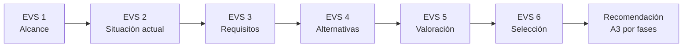
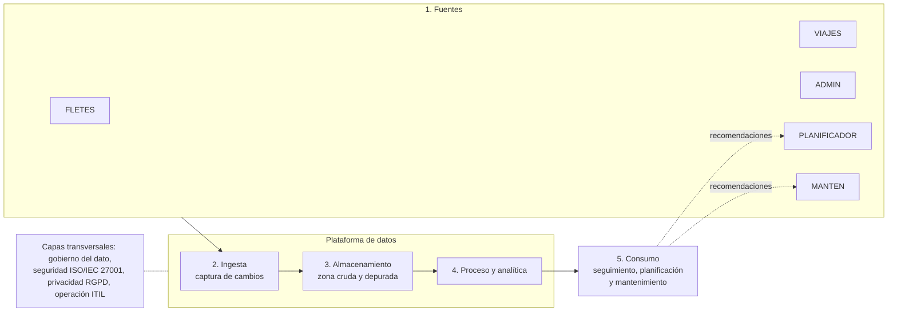
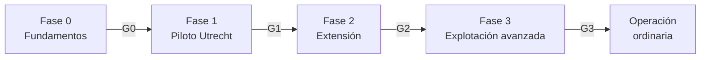

# 🚛 Estudio de Viabilidad – Sistema de Big Data en CTI

### *Estudio cualitativo de viabilidad (EVS): análisis de impacto, evaluación de alternativas y una propuesta ejecutable por fases*

**Asignatura: Servicios de Tecnología de la Información · UNIR · Actividad No. 1**

**[Contexto](#-contexto-y-alcance) • [Contenido](#-contenido-del-repositorio) • [Metodología](#-metodología) • [Arquitectura](#️-arquitectura-de-referencia) • [Hoja de ruta](#️-hoja-de-ruta-y-puertas-de-decisión) • [Lectura](#-lectura-del-documento) • [Autor](#-autor)**

---

## 📋 Tabla de Contenidos

- [🎯 Contexto y Alcance](#-contexto-y-alcance)
- [📁 Contenido del Repositorio](#-contenido-del-repositorio)
- [🧭 Metodología](#-metodología)
- [⚖️ Alternativas Evaluadas](#️-alternativas-evaluadas)
- [🏗️ Arquitectura de Referencia](#️-arquitectura-de-referencia)
- [🎯 Casos de Uso Priorizados](#-casos-de-uso-priorizados)
- [🗺️ Hoja de Ruta y Puertas de Decisión](#️-hoja-de-ruta-y-puertas-de-decisión)
- [⚠️ Riesgos Principales](#️-riesgos-principales)
- [🧩 Del Enunciado al Documento](#-del-enunciado-al-documento)
- [📖 Lectura del Documento](#-lectura-del-documento)
- [📚 Marcos y Normas de Referencia](#-marcos-y-normas-de-referencia)
- [📝 Nota](#-nota)
- [👤 Autor](#-autor)

---

## 🎯 Contexto y Alcance

Este repositorio contiene el documento de la **Actividad No. 1: Realización de un estudio de viabilidad** de la asignatura **Servicios de Tecnología de la Información** (UNIR), aplicado al caso de la **Compañía de Transporte Internacional, S.L. (CTI)**.

CTI opera con **1.200 camiones, 350 autobuses y 2.800 empleados** (2.200 conductores) en tres regiones, con cinco sistemas que no se comunican entre sí (ADMIN, FLETES, VIAJES, PLANIFICADOR y MANTEN). Sus clientes exigen entregas **just-in-time** que hoy no puede atender, y la utilización de la flota es baja. El estudio responde a una pregunta del Director General: **¿conviene implantar un sistema de Big Data?**

> **Enfoque:** estudio **cualitativo**, sin evaluación económica, caso de negocio ni indicadores, tal como pide el enunciado.
> **Ámbito:** procesos de negocio, personas y tecnología, con la región de Utrecht como zona de piloto.
> **Resultado:** acometer el proyecto **por fases y con condiciones** (alternativa **A3**), empezando por una Fase 0 de fundamentos.

### 🌟 ¿Qué aporta este estudio?

- 📊 **Análisis de impacto** del proyecto en procesos de negocio, personas y tecnología, con las acciones para mitigarlo (Tabla 3).
- ⚖️ **Evaluación cualitativa** de beneficios frente a factores en contra y una recomendación final razonada (Tabla 4).
- 🔀 **Cuatro alternativas** comparadas con criterios de Val IT, de no actuar a un Big Data integral.
- 🏗️ **Arquitectura de referencia por capas** que respeta los sistemas actuales en lugar de sustituirlos.
- 🔐 **Privacidad por diseño**: tratamiento por categoría de dato, base jurídica RGPD y evaluación de impacto (EIPD).
- 🗺️ **Hoja de ruta con puertas de decisión** y un análisis de sensibilidad que indica cuándo cambiaría la recomendación.

---

## 📁 Contenido del Repositorio

<table align="center">
  <tr><th>Elemento</th><th>Descripción</th></tr>
  <tr><td colspan="2"><b>📂 raíz</b></td></tr>
  <tr><td><code>Desarrollo_Actividad_1_Alejandro_De_Mendoza_Final.pdf</code></td><td>📄 <b>Documento final</b> del estudio de viabilidad: 14 páginas, 9 secciones, 12 tablas y 4 figuras</td></tr>
  <tr><td><code>README.md</code></td><td>📘 Este documento</td></tr>
  <tr><td><code>.gitignore</code></td><td>🚫 Lista blanca: solo se publican el PDF, el README y el propio <code>.gitignore</code>. Los archivos editables (Word) y el material de la actividad se conservan en local</td></tr>
</table>

### 📑 Estructura del documento

| Sección | Contenido |
|:---:|:---|
| **1** | Introducción: propósito con **resumen ejecutivo**, alcance, definiciones, referencias y visión general |
| **2** | Memoria explicativa: enfoque metodológico (Tabla 1), alternativas (Tabla 2), criterios, supuestos y límites |
| **3** | Situación actual de CTI (EVS 2) y requisitos de alto nivel R1–R6 (EVS 3) |
| **4** | **Análisis de impacto** en procesos de negocio, personas y tecnología (Tabla 3) |
| **5** | **Evaluación cualitativa y recomendación final** (Tabla 4) |
| **6** | Desarrollo adicional: arquitectura, casos de uso, valoración multicriterio, riesgos, RGPD, gobierno, RACI, hoja de ruta y sensibilidad (Tablas 5–12, Figuras 1–4) |
| **7–9** | Conclusiones, bibliografía y agradecimiento |

---

## 🧭 Metodología

El estudio sigue las actividades del **Estudio de Viabilidad del Sistema (EVS)** de Métrica v3, ajustadas al alcance cualitativo del encargo:

| Actividad del EVS | Dónde se recoge |
|:---|:---:|
| EVS 1. Establecimiento del alcance | Secciones 1 y 2.3 |
| EVS 2. Estudio de la situación actual | Sección 3.1 |
| EVS 3. Definición de requisitos | Sección 3.2 |
| EVS 4. Alternativas de solución | Sección 2.2 |
| EVS 5. Valoración de alternativas | Secciones 4, 5 y 6 |
| EVS 6. Selección de la solución | Secciones 5 y 6.7 |

Las alternativas se valoran con los cuatro ejes de **Val IT** (estrategia, arquitectura, valor y entrega) y se contrastan con los principios de gobierno de **ISO/IEC 38500**.

---

## ⚖️ Alternativas Evaluadas

| Alternativa | Valoración cualitativa | Resultado |
|:---|:---|:---:|
| **A0.** No actuar | Riesgo bajo, pero no resuelve la falta de puntualidad just-in-time ni la baja utilización de la flota | ❌ Descartada |
| **A1.** BI incremental sobre los sistemas actuales | Fácil de ejecutar, pero mantiene los datos en silos y no gestiona volumen, velocidad ni variedad | 🟡 Insuficiente como solución final |
| **A2.** Big Data integral en un solo despliegue | Máximo potencial teórico, pero la infraestructura no lo soporta y el riesgo organizativo y legal es muy alto | ❌ Descartada |
| **A3.** Big Data por fases | Equilibra beneficio y riesgo, aprende con un piloto y encaja con la estrategia y el gobierno de TI | ✅ **Seleccionada** |

---

## 🏗️ Arquitectura de Referencia

La plataforma **no modifica los sistemas actuales**: captura sus cambios, trabaja con datos mínimos y pseudonimizados desde la zona depurada, mantiene los datos en la UE con formatos abiertos y **cierra el ciclo** devolviendo recomendaciones a PLANIFICADOR y MANTEN.

---

## 🎯 Casos de Uso Priorizados

| Caso | Caso de uso | Decisión |
|:---:|:---|:---:|
| UC1 | Seguimiento de envíos casi en tiempo real | 🚀 Piloto |
| UC2 | Optimización de capacidad y retornos | 🚀 Piloto |
| UC4 | Previsión del 20 % de trabajo urgente o puntual | 🚀 Piloto |
| UC8 | Calidad y conciliación del dato FLETES-ADMIN | 🧱 Habilitador (Fases 0 y 1) |
| UC3 | Mantenimiento predictivo | Fase 2, tras consulta laboral y EIPD |
| UC5 | Analítica y segmentación de clientes | Fase 2 |
| UC6 | Análisis de reservas de pasajeros | Fase 2 |
| UC7 | Consumo de combustible y emisiones | Fase 3 |

---

## 🗺️ Hoja de Ruta y Puertas de Decisión

Cada fase avanza en cuatro frentes (gobierno y cumplimiento, personas y cambio, tecnología y casos de uso) y termina con una **decisión del Director General** basada en condiciones verificables, sin fechas ni cifras porque dependen del caso de negocio posterior.

| Puerta | Decide | Condición principal para avanzar |
|:---:|:---|:---|
| **G0** | Autorizar el piloto | EIPD completada sin riesgo residual alto y consulta a los representantes de los trabajadores cerrada |
| **G1** | Extender a Düsseldorf, Orange y Pasajeros | Piloto con datos fiables, integrado con PLANIFICADOR y usado para decidir |
| **G2** | Pasar a explotación avanzada | Las tres regiones conectadas con datos consistentes y VIAJES integrado respetando el RGPD |
| **G3** | Cerrar el programa | Valor demostrado y sostenible, con responsables permanentes del dato |

<b>🔄 Ver análisis de sensibilidad: qué cambiaría la recomendación</b>

| Si ocurre que… | Entonces la recomendación se ajusta así |
|:---|:---|
| La EIPD concluye un riesgo alto no mitigable sobre datos de conductores | Se renuncia a la telemática individual y se continúa con datos de pedidos y vehículos |
| No se moderniza la WAN ni se retira el dial-up en las oficinas del piloto | No se pasa a la Fase 1; se mantiene A1 mientras tanto |
| El caso de negocio económico no es favorable | Se queda en A1 y se reevalúa en el siguiente ciclo de planificación |
| El proveedor no garantiza datos en la UE ni niveles de servicio | No se contrata; se explora otra alternativa |
| El Director General no confirma el patrocinio | Se pospone: sin patrocinio no hay capacidad de entrega |
| Los clientes exigen visibilidad antes de lo previsto | Se aceleran UC1 y UC4 dentro del piloto, sin saltarse la EIPD |

---

## ⚠️ Riesgos Principales

El documento registra **10 riesgos** valorados por probabilidad e impacto (Figura 3 y Tabla 7). Los de mayor exposición:

| ID | Riesgo | P | I | Respuesta |
|:---:|:---|:---:|:---:|:---|
| R1 | Tratar datos personales de forma desproporcionada | M | A | Datos mínimos por caso de uso, EIPD previa y pseudonimización |
| R2 | Rechazo de conductores y representantes de los trabajadores | A | A | Consulta temprana, finalidad limitada y datos por vehículo |
| R3 | Red e infraestructura insuficientes | A | M | Modernizar la WAN, retirar el dial-up y plataforma escalable en la UE |
| R4 | Datos inconsistentes entre sistemas y países | A | M | Gobierno del dato, glosario común y conciliación FLETES-ADMIN |
| R6 | Poca implicación directiva y TI fragmentada | M | A | Patrocinio del Director General y comité de datos con las tres regiones |
| R7 | Alcance difuso («toda la información») | A | M | Casos de uso priorizados y puertas de decisión |

*P = probabilidad, I = impacto (B bajo, M medio, A alto).*

---

## 🧩 Del Enunciado al Documento

| Requisito de la actividad | Cómo lo resuelve el documento |
|:---|:---|
| **Estudio de viabilidad cualitativo** | Sin cifras económicas, caso de negocio ni indicadores (sección 2.3) |
| **Análisis de impacto** en procesos de negocio, personas y tecnología | Tabla 3, con el impacto y las acciones para mitigarlo (sección 4) |
| **Evaluación cualitativa** con beneficios, factores en contra y recomendación | Tabla 4, con la recomendación final (sección 5) |
| **Explicación de cómo se aborda** el problema | Memoria explicativa: metodología EVS, alternativas, criterios y supuestos (sección 2) |
| **Capacidad de análisis** | Desarrollo adicional: arquitectura, casos de uso, riesgos, RGPD, gobierno y hoja de ruta (sección 6) |

---

## 📖 Lectura del Documento

1. Abrir el archivo `Desarrollo_Actividad_1_Alejandro_De_Mendoza_Final.pdf`.
2. Consultar el **Resumen ejecutivo** en la sección 1.1.
3. Revisar la **Tabla 3** (sección 4) y la **Tabla 4** (sección 5).
4. Profundizar en el **Desarrollo adicional** (sección 6).

---

## 📚 Marcos y Normas de Referencia

| Marco o norma | Uso en el estudio |
|:---|:---|
| **Métrica v3 (EVS)** | Estructura del estudio de viabilidad |
| **Val IT** | Criterios de valoración de las alternativas: estrategia, arquitectura, valor y entrega |
| **ISO/IEC 38500** | Principios de gobierno de TI aplicados al proyecto |
| **ITIL / ISO/IEC 20000** | Operación del sistema como servicio |
| **ISO/IEC 27001** | Seguridad de la información |
| **RGPD (Reglamento UE 2016/679)** | Base jurídica, minimización y evaluación de impacto (EIPD) |
| **Matriz RACI** | Asignación de responsabilidades del proyecto |

---

## 📝 Nota

Este documento corresponde a una **actividad académica** y se elaboró con fines exclusivamente formativos. CTI es el caso de estudio propuesto por la asignatura.

---

## 👤 Autor

Este trabajo fue desarrollado en el marco de la asignatura **Servicios de Tecnología de la Información** de la **Fundación Universitaria Internacional de La Rioja (UNIR)**, Bogotá D.C., bajo la orientación de los docentes **Johan Sebastián Giraldo Hurtado** y **Glenn Elmer Hernández Camelo**.

| Autor | Perfil |
|:---:|:---:|
| ***Alejandro De Mendoza*** |  |

---

### 🚛 *Primero la calidad del dato; después, el volumen*

**Servicios de Tecnología de la Información · Estudio de Viabilidad CTI**

