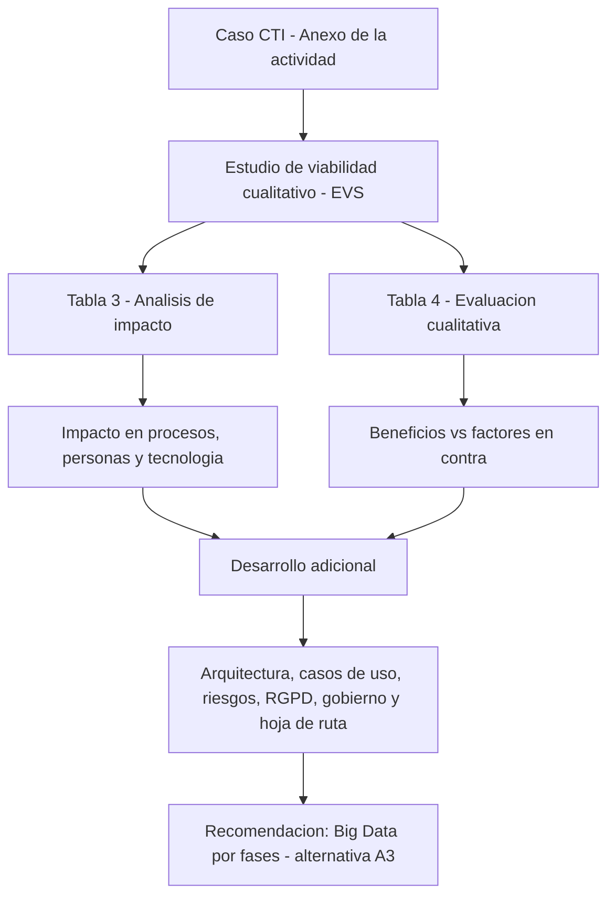

# Estudio de Viabilidad - Sistema de Big Data en CTI - Servicios de Tecnología de la Información

---

Este repositorio contiene el documento de la **Actividad No. 1: Realización de un estudio de viabilidad**
de la asignatura **Servicios de Tecnología de la Información** (UNIR), aplicado al caso de la
**Compañía de Transporte Internacional, S.L. (CTI)**. Es un estudio **cualitativo** sobre la
conveniencia de implantar un sistema de Big Data.

## Contenido del repositorio:

- `Desarrollo_Actividad_1_Alejandro_De_Mendoza_Final.pdf` → Documento final con el estudio de viabilidad: memoria explicativa, Tabla 3 de análisis de impacto, Tabla 4 de evaluación cualitativa y recomendación, y desarrollo adicional (arquitectura de referencia, casos de uso, riesgos, RGPD, gobierno, hoja de ruta y sensibilidad).
- `README.md` → Descripción del repositorio.
- `.gitignore` → Excluye los archivos editables (Word) y el material de la actividad, que solo se conservan en local.

## Arquitectura

## Lectura del documento:

1. Abrir el archivo `Desarrollo_Actividad_1_Alejandro_De_Mendoza_Final.pdf`.
2. Consultar el **Resumen ejecutivo** en la sección 1.1.
3. Revisar la **Tabla 3** (sección 4) y la **Tabla 4** (sección 5).
4. Profundizar en el **Desarrollo adicional** (sección 6).

## Contenido del informe

El documento incluye:

- Memoria explicativa con el enfoque metodológico y las alternativas evaluadas.
- Análisis de impacto en procesos de negocio, personas y tecnología.
- Evaluación cualitativa con beneficios, factores en contra y recomendación final.
- Arquitectura de referencia, casos de uso priorizados, matriz de riesgos, cumplimiento RGPD, RACI y puertas de decisión.
- Conclusiones y bibliografía.

## Autor:

Este trabajo fue desarrollado en el marco de la asignatura **Servicios de Tecnología de la Información**.

- ***Alejandro De Mendoza*** – [Perfil GitHub](https://github.com/AlejoTechEngineer)

---
